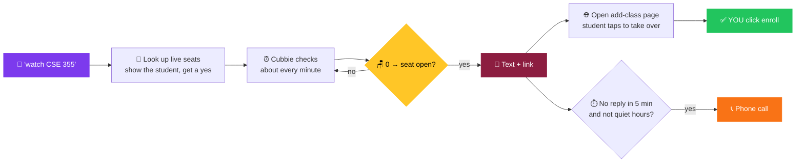

<div align="center">

# 🎯 Seat Sniper

### Your ASU class is full. Cubbie isn't giving up.

**Text Cubbie your full class. It texts, then calls, the second a seat opens. You hit enroll.**

<br/>


<br/>

🏆 Built for the **[Cubbie Hackathon](https://hackathon.cubbie.ai)** · Track 1 · Cubbie Skills

</div>

---

## 😩 The problem

It's registration week. **CSE 355 is 150 / 150.** You refresh Class Search between classes, at lunch, at 1 am.
A seat opens at 2:07 am. Someone else grabs it at 2:09.

## ⚡ See it

<div align="center">



<br/><br/>

| 💬 **Ask** | 🎯 **Lock on** | 🌙 **Sleep** | 🚨 **2:07 am** | 📞 **Ring ring** | ✅ **Enrolled** |
| :---: | :---: | :---: | :---: | :---: | :---: |
| *"snipe CSE 355"* | Live ASU seats, you say yes | Cubbie checks about every minute | Text + add-class link | Missed it? It calls | **You** tap enroll |

<sub>Illustration of the flow. In a real chat the seat numbers come live from ASU Class Search.</sub>

</div>

## 🔄 How it works



## ✨ Features

| | |
| --- | --- |
| 🎯 **Snipe a section** | Watch one class number |
| 👩‍🏫 **Or the whole course** | Any lecture of CSE 355, or only Prof Lee's, only Tempe, only online |
| 📱 **Text → 📞 call** | Texts first, calls after 5 minutes of silence |
| 🌙 **Quiet hours** | 10 pm to 7:30 am: text only, no 2 am phone calls (you pick the hours) |
| 🌐 **Browser handoff** | Opens the ASU add-class page; you sign in and tap enroll |
| 🔁 **Alert once, re-arm** | One alert per opening. Filled again? Re-armed automatically |
| 🚨 **Never silently blind** | 3 failed checks in a row and you get told, not left guessing |
| ⌛ **Auto-expires** | Stops after 30 days or the enrollment deadline. Nothing watched forever |
| 🧠 **Remembers you** | Call preference and quiet hours asked once, ever |

## 🛡️ What it will never do

> ❌ Enroll, drop, swap or pay &nbsp;·&nbsp; ❌ Ask for your ASU password &nbsp;·&nbsp; ❌ Text anyone but you
>
> **You always make the final click.** Seat Sniper only watches public seat counts, the same numbers anyone sees on ASU Class Search.

## 📲 Install (10 seconds)

Text this link to **Cubbie**:

```text
https://github.com/Harshith241/Seat-Sniper
```

Then: *"watch CSE 355 for me"*. That's it. No app, no account, no key.

## 🧪 Try it without a full class

```bash
python3 scripts/check_seats.py check --sample --now "2026-10-24T16:30"
```

```text
SAMPLE ALERT w1 seats=2 total=40 waitlist=0 call=yes cls=99001 link=https://go.oasis.asu.edu/addclass/?STRM=2271&ASU_CLASS_NBR=99001 | CSE 355 (Prof Sample) ...
SAMPLE DONE alerts=1 closed=0 errors=0 needs_human=0 expired=0
```

Sample mode uses fake data in a throwaway folder. It never touches real watches.

## 🔧 Under the hood

```text
seat-sniper/
├── SKILL.md                 🧠 what Cubbie reads: when to trigger, steps, replies, boundaries
├── scripts/check_seats.py   ⚙️  add · check · watch · list · remove · snooze · ack · prefs   (--sample, --json)
├── assets/sample_seats.json 🎭 fake demo data, clearly labeled
├── tests/                   ✅ 29 unit tests + a real trimmed ASU response
└── spike/NOTES.md           🔬 how the ASU data source works (verified 2026-10-24)
```

- **Data:** the same JSON feed the public ASU Class Search page calls. One request per watch, 30 s timeout, 1 s
  between watches, a polite User-Agent, at most 10 watches per student. [Details →](spike/NOTES.md)
- **Split of work:** the script only fetches, compares, saves state and prints one machine word per line
  (`ALERT`, `CLOSED_AGAIN`, `NEEDS_HUMAN`, ...). Cubbie does the texting, calling, scheduling and browser.
- **Zero setup:** Python standard library only. State lives in `~/.config/seat-sniper/watches.json`.

```bash
python3 -m unittest discover tests        # 29 tests, no network
```

## ⚠️ Honest limits

- ASU only.
- Checks about once a minute (30 s at the fastest), so a seat that opens and fills within seconds can still be missed.
- It reads public seat counts. It can't see holds, prerequisites or reserved seats on your account.

---

<div align="center">

Made with 💜 and too many refreshes of Class Search · Fork it for your school

**[Vote for Seat Sniper on hackathon.cubbie.ai →](https://hackathon.cubbie.ai/#gallery)**

</div>
